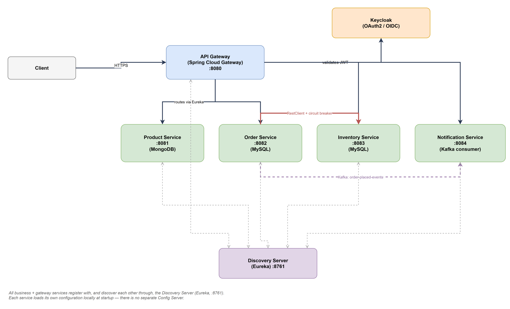

# Distributed E-Commerce Order Management System

A Spring Boot microservices capstone project for the Master of Science in
Computer Science program.

## Overview

This system models a distributed e-commerce order pipeline as six
independently deployable Spring Boot services - Product, Order, Inventory,
and Notification, fronted by a Spring Cloud Gateway and backed by a Eureka
service registry. Placing an order synchronously reserves stock from
Inventory Service (a RestClient-backed HTTP call guarded by a Resilience4J
circuit breaker and retry, with saga-lite compensation if a later item
fails) and, on success, asynchronously notifies the customer via a Kafka
event the Notification Service consumes. Every request is authenticated
and authorized with Keycloak (OAuth2/OIDC) at the gateway, and each service
owns its own datastore - MongoDB for the product catalog, separate MySQL
schemas (with Flyway migrations) for orders and inventory - following the
database-per-service pattern. The whole stack is containerized and
orchestrated locally with Docker Compose, with unit and
Testcontainers-backed integration tests covering each service.

## Configuration approach

Every service carries its own configuration locally, in its own
`src/main/resources/application.yml`. Environment-specific values
(`MONGODB_URI`, `ORDER_DB_URL`, `KEYCLOAK_ISSUER_URI`,
`KAFKA_BOOTSTRAP_SERVERS`, etc.) are supplied at container startup through
Docker Compose environment blocks. This keeps the system simple to start up
locally, with one fewer moving part - the trade-off is that changing a
shared setting (e.g. Eureka lease timing, or actuator endpoint exposure)
means editing it in every service individually rather than in one place,
and there's no `/actuator/refresh` to push config changes without a
restart. A centralized, Git-backed Spring Cloud Config Server is a planned
future enhancement (see `docs/Project_Report.docx` §14.4 "Config Server
(Centralized Configuration Management)").

## Architecture at a glance



All business + gateway services register with, and discover each other
through, the Discovery Server (Eureka, :8761). Each service loads its own
configuration locally at startup - there is no separate Config Server.

## Prerequisites

- Java 21 (`java -version`)
- Maven 3.9+ (or use the Maven wrapper if you add one)
- Docker Desktop (Docker Engine + Docker Compose v2) with **at least 6 GB**
  of memory allocated - this stack runs 7 Spring Boot services plus MongoDB,
  two MySQL instances, Kafka, and Keycloak

## One-time setup: Keycloak hostname

The Docker Compose file runs Keycloak with a fixed hostname (`keycloak`) so
that the `iss` (issuer) claim inside every access token is identical whether
the token is validated by a container on the Docker network (the API
Gateway) or requested by a tool running on your host machine (Postman,
curl, a browser). For that to work, `keycloak` must resolve to `127.0.0.1`
from your host too:

- **Windows**: open `C:\Windows\System32\drivers\etc\hosts` in a text editor
  **run as Administrator** and add:
  ```
  127.0.0.1  keycloak
  ```
- **macOS / Linux**: `sudo nano /etc/hosts` and add the same line.

(This is a well-known Keycloak-in-Docker gotcha - see the "Challenges"
section of the project report for how it was diagnosed.)

## Running everything with Docker Compose

```bash
docker compose up --build
```

This builds each service's jar inside a multi-stage Docker build (no need
to run Maven yourself first) and starts the full stack. First boot takes a
few minutes while images build and Kafka/Keycloak/MySQL initialize. Once
everything is healthy:

| Service | URL |
|---|---|
| API Gateway | http://localhost:8080 |
| Eureka dashboard | http://localhost:8761 (user: `admin` / pass: `admin`) |
| Keycloak admin console | http://keycloak:8180 (user: `admin` / pass: `admin`) |
| Product Service Swagger UI | http://localhost:8081/swagger-ui.html |
| Order Service Swagger UI | http://localhost:8082/swagger-ui.html |
| Inventory Service Swagger UI | http://localhost:8083/swagger-ui.html |
| Notification Service Swagger UI | http://localhost:8084/swagger-ui.html |

Demo Keycloak users (seeded via `docker/keycloak/realm-export.json`):

| Username | Password | Roles |
|---|---|---|
| `demo-admin` | `AdminPass123!` | ADMIN, CUSTOMER |
| `demo-customer` | `CustomerPass123!` | CUSTOMER |

## Running services locally (without Docker), for development

Start infrastructure only:

```bash
docker compose up mongodb mysql-order mysql-inventory kafka keycloak
```

Then, in separate terminals, from the repo root:

```bash
mvn -pl discovery-server spring-boot:run
mvn -pl product-service spring-boot:run
mvn -pl inventory-service spring-boot:run
mvn -pl order-service spring-boot:run
mvn -pl notification-service spring-boot:run
mvn -pl api-gateway spring-boot:run
```

Start the Discovery Server first and wait for it to be up before starting
the others - every other service registers itself with Eureka on startup.
Each service loads its own configuration from its bundled
`application.yml`, so there's no separate config service to wait on.

## Trying the API end-to-end

A ready-to-import Postman collection covering every endpoint below (plus infra
health checks, Keycloak token requests that auto-populate a bearer token for
every other request, and a few deliberate 400/401/403/409 negative-path
requests) is at
[`postman/Ecommerce-Order-Management.postman_collection.json`](postman/Ecommerce-Order-Management.postman_collection.json).
Import it into Postman and follow the numbered folders top to bottom, or use
the manual curl walkthrough below.

1. **Get a token** (client credentials are for the public `ecommerce-client`):
   ```bash
   curl -X POST http://keycloak:8180/realms/ecommerce/protocol/openid-connect/token \
     -H "Content-Type: application/x-www-form-urlencoded" \
     -d "client_id=ecommerce-client&grant_type=password&username=demo-admin&password=AdminPass123!"
   ```
   Copy the `access_token` value from the response.

2. **Create a product** (admin only):
   ```bash
   curl -X POST http://localhost:8080/api/products \
     -H "Authorization: Bearer <token>" -H "Content-Type: application/json" \
     -d '{"sku":"SKU-100","name":"Wireless Mouse","category":"Electronics","price":19.99,"initialStockHint":50}'
   ```

3. **Seed stock for that SKU** (admin only, direct to Inventory Service or via gateway):
   ```bash
   curl -X POST http://localhost:8080/api/inventory \
     -H "Authorization: Bearer <admin-token>" -H "Content-Type: application/json" \
     -d '{"sku":"SKU-100","availableQuantity":50}'
   ```

4. **Browse the catalog** (public, no token needed):
   ```bash
   curl http://localhost:8080/api/products
   ```

5. **Place an order** (customer or admin token):
   ```bash
   curl -X POST http://localhost:8080/api/orders \
     -H "Authorization: Bearer <token>" -H "Content-Type: application/json" \
     -d '{"customerId":"customer-1","items":[{"sku":"SKU-100","quantity":2,"unitPrice":19.99}]}'
   ```
   This synchronously reserves stock via the Inventory Service (RestClient +
   Resilience4J circuit breaker) and, on success, publishes an
   `order-placed-events` Kafka message.

6. **Check the Notification Service picked it up**:
   ```bash
   curl -H "Authorization: Bearer <token>" http://localhost:8080/api/notifications
   ```

7. **Exercise the circuit breaker**: stop the Inventory Service
   (`docker compose stop inventory-service`) and place a few more orders -
   after enough failures the breaker opens (see
   `GET http://localhost:8082/actuator/health` -> `circuitBreakers` for
   state, or `GET http://localhost:8082/actuator/circuitbreakers`).

## Running the automated tests

```bash
mvn test
```

Each business service's integration tests (in `src/test/.../integration/`)
spin up real MongoDB/MySQL/Kafka instances via Testcontainers - a Docker
daemon must be reachable from wherever you run the build (this is the same
requirement Testcontainers always has).

### Code coverage (JaCoCo)

`mvn test` also runs each module through the JaCoco Maven plugin (configured
once in the parent `pom.xml`, inherited by every module), producing an HTML
coverage report per module at:

```
<module>/target/site/jacoco/index.html
```

Open that file in a browser for a line/branch coverage breakdown by package
and class. No minimum coverage threshold is enforced yet (see the project
report's Testing section) - add a `jacoco:check` execution with a `<rules>`
block once a baseline has been measured, if you want the build to fail below
a chosen percentage.

## Project layout

```
ecommerce-order-management/
├── discovery-server/     # Eureka service registry
├── api-gateway/          # Spring Cloud Gateway + Keycloak-backed security
├── product-service/      # Product catalog (MongoDB)
├── order-service/        # Order placement, RestClient + circuit breaker, Kafka producer
├── inventory-service/    # Stock tracking/reservation (MySQL + Flyway)
├── notification-service/ # Kafka consumer, order-confirmation notifications
├── docker/keycloak/      # Keycloak realm export (roles, client, demo users)
├── docker-compose.yml    # Full local orchestration
└── docs/                 # Project plan and project report
```

## Scope notes

A centralized Config Server, Kubernetes, a full observability stack
(distributed tracing / log aggregation / metrics dashboards), and an MCP
(Model Context Protocol) server were deliberately scoped out of this
iteration to fit the project timeline - see the report's "Future Work"
section.
